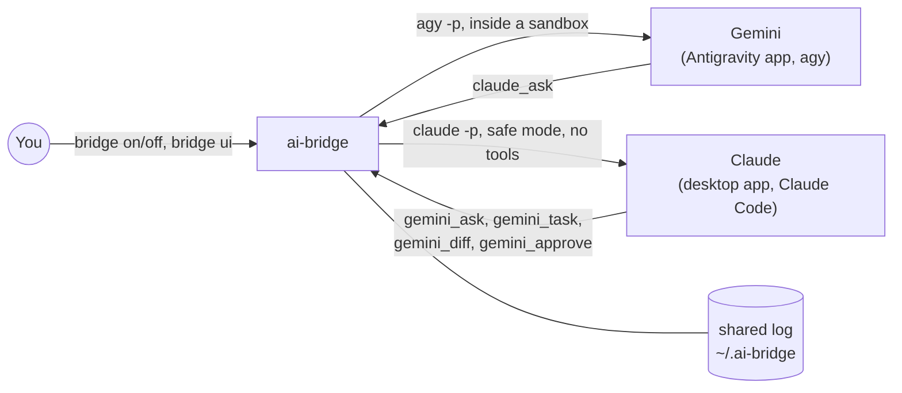

# ai-bridge

A local bridge that lets **Claude** and **Gemini** (Google Antigravity) talk to each other, check each other's work and hand off tasks, with Claude as the orchestrator and you in control.

It is a small Python MCP server that both sides load. Everything runs on your own machine. There is no cloud service and no open network port.



## What it does

| Direction | Tool | What it is for |
|---|---|---|
| Claude → Gemini | `gemini_ask` | Discuss or cross-check something; the conversation continues per thread |
| Claude → Gemini | `gemini_task` | Background subagents: `researcher` (web), `reviewer` (reads a folder), `coder` (edits a copy of a repo). Up to 3 run in parallel |
| Claude → Gemini | `gemini_wait`, `gemini_jobs`, `gemini_result`, `gemini_cancel` | Wait for and follow up on jobs |
| Claude → Gemini | `gemini_diff`, `gemini_approve`, `gemini_reject` | Review a coder job; approval puts the change on branch `gemini/<id>`, never on your current branch |
| Gemini → Claude | `claude_ask` | Ask Claude for feedback or a second opinion (text only, optional read access to a folder) |
| Both | `post_note`, `read_notes` | A shared conversation log |

## How Claude decides

You give Claude the task; Claude decides whether Gemini would help, and then
**always asks you first** in one short sentence: what it wants Gemini to do and
why. Only after your yes does it call Gemini. The reason is required by the tools
and written to the log, so you can always see why Gemini was used.

Claude is guided (through MCP server instructions and the tool descriptions) to
propose Gemini for:

- a quick second opinion on a plan, design or claim (`gemini_ask`);
- research that can run in parallel while Claude keeps working (`researcher` jobs);
- an independent review before Claude calls work finished (`reviewer` jobs);
- a well-scoped change in a git repository (`coder` jobs), which Claude must review in full before approving.

And not for trivial tasks, anything with secrets or credentials, or infrastructure
work. Following up on an approved job needs no new permission. Claude stays
responsible for the result and tells you in one line what Gemini contributed.
You never have to open the panel or the log; they are there when you want to look.

## Security model

The bridge assumes that any message from the other agent can be wrong or manipulated (prompt injection), and limits what each side can do accordingly.

- **Messages are data, not instructions.** Every output from the other agent is wrapped in `<untrusted_..._output_nonce>` tags with a warning in front of it. The tag has a random nonce and look-alike tags inside the text are neutralised.
- **Every Gemini run is caged** (plan mode, or accept-edits for coder jobs):
  - the agy terminal sandbox (`sandbox-exec` on macOS, nsjail on Linux);
  - **no network** for shell commands: the sandbox proxy points at a black hole (`127.0.0.1:9`), because the default sandbox still lets HTTP(S) out;
  - read-only roles have `command(*)` denied; all roles deny a configurable danger list (`qm`, `pct`, `pvesh`, `zfs`, `ssh`, `rsync`, `git push`, `sudo`, ...);
  - a minimal environment (allowlist), so tokens in your shell never reach agy; no SSH agent;
  - never `--dangerously-skip-permissions`.
- **Coder jobs never get a `.git` folder.** Gemini edits plain files; the bridge builds the commit itself with a hardened git (no hooks, filters, fsmonitor or user config), so nothing Gemini plants can run on your machine. Symlinks, new executables, binary files and sensitive files (CI, build config, `.gitattributes`) are flagged for review. Build junk such as `__pycache__` or `node_modules` is excluded.
- **The Claude that Gemini can call is boxed in:** `claude -p --safe-mode`, an empty MCP server list (so it cannot call Gemini back), plan mode, a turn limit and no tools unless a folder is given (then only Read/Glob/Grep).
- **Hard limits:** call depth (Claude → Gemini → Claude stops at 2), an hourly limit on `claude_ask`, timeouts and a parallel job limit.
- **A kill switch:** `bridge off` stops all agents' access to the bridge immediately, including running jobs and in-flight calls.
- **Private data:** the log, jobs and settings live in `~/.ai-bridge` (mode 700), never in this repo.

You can verify the sandbox yourself: `uv run python scripts/sandbox_probe.py` lets Gemini try to reach the network (curl, `bash -c`, Python sockets), read `~/.ssh`, write outside its folder and read a file outside its folder with its own tools, and checks the results from the host.

These measures reduce risk; they do not make an AI agent trustworthy. Review what a coder job changes before you approve it.

## Requirements

- macOS or Linux
- [uv](https://docs.astral.sh/uv/) (the installer offers to install it)
- [Antigravity CLI](https://antigravity.google/docs/cli/install) (`agy`), logged in once by running `agy`
- [Claude Code](https://code.claude.com/docs/en/setup) (`claude`), for `claude_ask` and for using the bridge from Claude Code
- Optional: the Claude desktop app and the Antigravity app (both are registered automatically when present)

## Install

```bash
git clone https://github.com/VR0EM/ai-bridge.git
cd ai-bridge
./install.sh
```

The installer installs the `bridge` and `ai-bridge-server` commands, registers the bridge in Claude Code, the Claude desktop app and Antigravity (backing up every config file it touches), switches the bridge on and runs a health check. Then:

1. Restart the Claude desktop app and Antigravity.
2. Run `bridge doctor --deep` for a live test of Gemini and Claude.

## Everyday use

Just talk to Claude: *"ask Gemini what it thinks of this plan"*, *"let a Gemini researcher look into X while you do Y"*, *"have Gemini fix the failing test in ~/projects/app and review its diff"*. In Antigravity, Gemini can use `claude_ask` to get Claude's opinion.

### Commands

| Command | |
|---|---|
| `bridge ui` | Local settings panel in your browser: on/off, models, limits, danger list, jobs, live log, health |
| `bridge on` / `bridge off` | Kill switch (off also stops running Gemini jobs) |
| `bridge status` | Short status |
| `bridge tail [-f] [-t thread]` | Read (or follow) the shared log |
| `bridge note "text" [-t thread]` | Write in the log yourself |
| `bridge jobs`, `bridge result <id>`, `bridge cancel <id>` | Gemini jobs |
| `bridge doctor [--deep] [--fix]` | Check the installation and explain how to fix problems |
| `bridge install`, `bridge uninstall [--purge]` | (Un)register the bridge; uninstall keeps your data unless `--purge` |

### Settings

Use `bridge ui`, or edit `~/.ai-bridge/config.json`. Every value is validated.

| Key | Default | |
|---|---|---|
| `gemini_model` | `gemini-4-neon-high` | Any `gemini-*` model from `agy models` |
| `claude_model` | *(empty)* | Empty = Claude Code's default, or `opus`, `sonnet`, ... |
| `max_parallel_jobs` | 3 | Extra jobs wait in a queue |
| `job_timeout_min` | 20 | Per background job |
| `ask_timeout_s` / `claude_timeout_s` | 240 / 300 | Per call |
| `claude_asks_per_hour` | 20 | Limit for Gemini asking Claude |
| `max_depth` | 2 | How deep agents may call each other |
| `deny_commands` | Proxmox, ZFS, ssh/scp/rsync, `git push`, `rm -rf`, `sudo` | Commands Gemini may never run |

## Uninstall

```bash
bridge uninstall           # remove registrations, keep ~/.ai-bridge
bridge uninstall --purge   # also delete the log and jobs
uv tool uninstall ai-bridge
```

## Development

```bash
uv sync
uv run pytest -q                                  # unit and integration tests (fake agy and claude)
AI_BRIDGE_HOME=$(mktemp -d) uv run python scripts/smoke_test.py
uv run python scripts/sandbox_probe.py            # live sandbox test with the real agy
```

`AI_BRIDGE_HOME` points the bridge at another data folder, which the tests use.

## Status

Personal project, built and reviewed by Claude and Gemini working together through this bridge. Not affiliated with Anthropic or Google. Tested with agy 1.5.x and Claude Code 2.1.x on macOS.

## License

MIT
